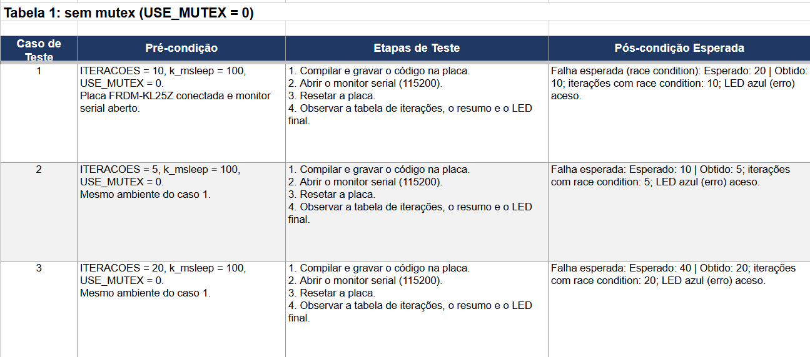
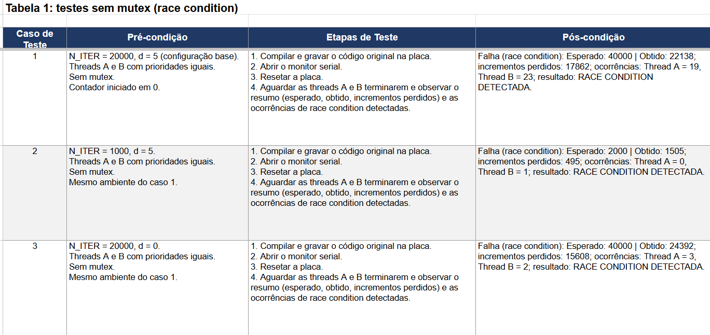
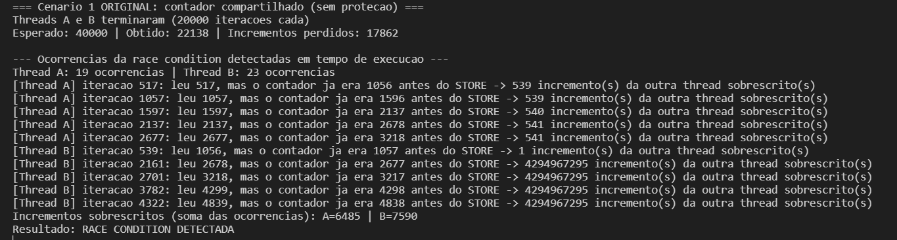
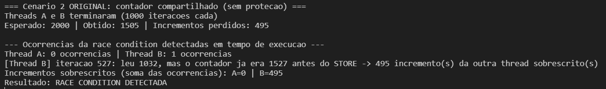
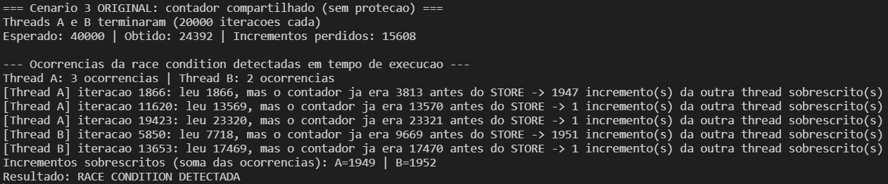
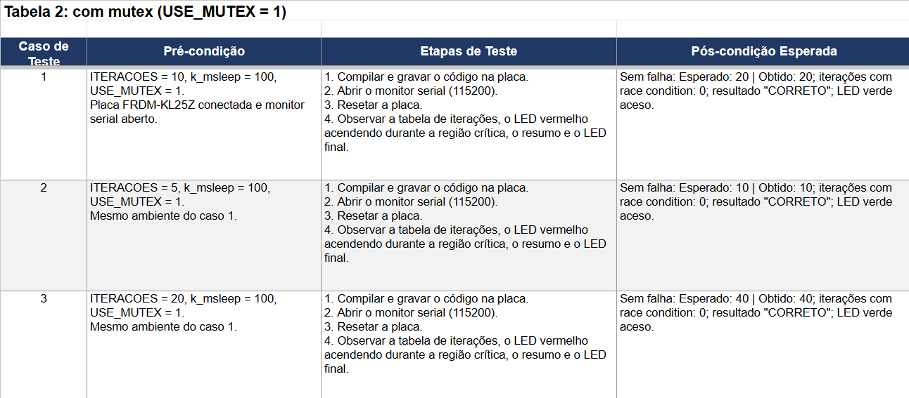
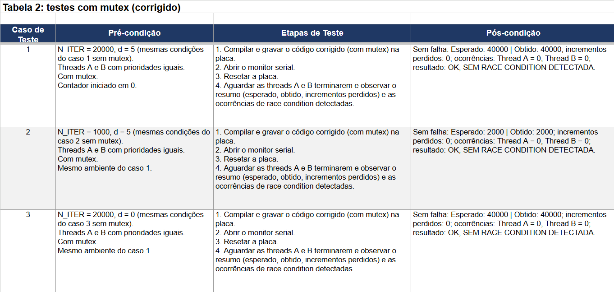
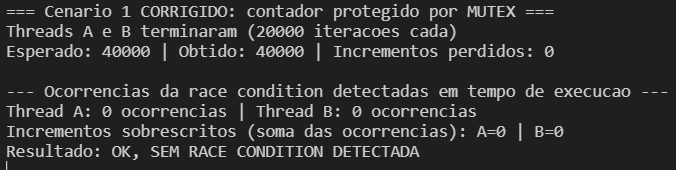
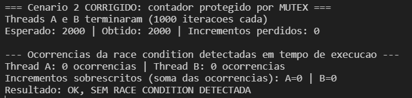
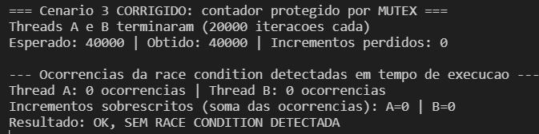

# Contexto geral

## Kenny

Na parte 1, que é a etapa sem mutex, duas threads (A e B) incrementam uma variável chamada `contador` `N_ITER` vezes cada uma. O valor final esperado é `2 × N_ITER` e o comando `contador++` ocorre em três etapas: LOAD, ADD e STORE. Se o escalonador alterna a thread entre o LOAD e o STORE, a outra thread pode escrever um valor que será depois sobrescrito por um valor antigo, fazendo com que alguns incrementos sejam perdidos. O parâmetro `d` define o tempo de uma espera entre o LOAD e o STORE, ampliando a janela de tempo para essa troca. O código também verifica se isso acontece: antes do STORE, a thread faz uma nova leitura do contador e, se o valor mudou desde o LOAD, registra a mudança.

Já na parte 2, a operação é semelhante em relação à parte 1, porém foi escolhido o mutex, já que participa em toda a sequência LOAD, ADD e STORE. Quando uma thread entra na região crítica, a outra fica bloqueada em `k_mutex_lock` (travar o mutex) até a primeira chamar `k_mutex_unlock` (liberar o mutex), fazendo com que só uma thread por vez lê e escreva no contador, e nenhum incremento é sobrescrito.

# Parte 1: testes com race condition (sem proteção)

*tabela de resultados sem Mutex (Davi)*

*tabela de resultados sem Mutex (Kenny)*

## Caso 1: configuração base (Kenny)

**Pré-condições**

- `N_ITER` = 20000
- `d` = 5
- Threads A e B com prioridades iguais
- Sem mutex (seção crítica desprotegida)
- Contador iniciado em 0

**Etapas de teste**

- Gravar o código original na placa e abrir o monitor serial.
- As duas threads são criadas com a mesma prioridade e executam em revezamento das threads por fatias de tempo.
- Cada thread repete 20000 vezes: lê o contador (LOAD), espera `d`, relê o contador para detecção, soma 1 (ADD) e grava o resultado (STORE).
- Como não há proteção, uma thread pode ser interrompida entre o LOAD e o STORE, e a outra altera o contador nesse intervalo.
- Ao final, a thread principal imprime esperado, obtido e as ocorrências registradas.

**Pós-condições**

- Esperado: obtido = 40000, 0 ocorrências.
- Obtido: 22138, com 17862 incrementos perdidos. A thread A registrou 19 ocorrências e a B registrou 23.
- A divergência entre 40000 e 22138 mostra que muitos incrementos foram sobrescritos, demonstrando race condition. Os logs no serial monitor mostram isso: em vários pontos a thread leu um valor e, antes de gravar, o contador já tinha avançado.
- Nos logs da thread B aparece o valor 4294967295. Ele surge porque a subtração entre o que o contador leu antes do STORE e no LOAD ficou negativo em uma variável inteira sem sinal de 32 bits (resultado negativo que vira um número enorme), então não representa uma quantidade real de incrementos. Isso também afeta a soma das ocorrências da thread B (7590).

## Caso 2: menos números de iterações (Kenny)

**Pré-condições**

- `N_ITER` = 1000
- `d` = 5
- Threads com prioridades iguais
- Sem mutex
- Contador iniciado em 0

**Etapas de teste**

- Mudar o código original com `N_ITER` = 1000 e abrir o monitor serial.
- O procedimento das threads é o mesmo do Caso 1 (LOAD, espera, detecção, ADD, STORE), mas com menos repetições.
- Ao final, comparar o valor obtido com o esperado.

**Pós-condições**

- Esperado: obtido = 2000, 0 ocorrências.
- Obtido: 1505, com 495 incrementos perdidos. A thread A registrou 0 ocorrências e a B registrou 1.
- Mesmo com menos iterações, houve divergência, havendo race condition. Com menos iterações o código passa menos tempo na seção crítica, o que reduziu o número de ocorrências em relação ao Caso 1.

## Caso 3: alteração do parâmetro d (Kenny)

**Pré-condições**

- `N_ITER` = 20000
- `d` = 0
- Threads com prioridades iguais
- Sem mutex
- Contador iniciado em 0

**Etapas de teste**

- Gravar o código original com `d` = 0
- O fluxo das threads é o mesmo dos casos anteriores, mas sem alargar a janela entre o LOAD e o STORE.
- Ao final, comparar o valor obtido com o esperado.

**Pós-condições**

- Esperado: obtido = 40000, 0 ocorrências.
- Obtido: 24392, com 15608 incrementos perdidos. A thread A registrou 3 ocorrências e a B registrou 2.
- Mesmo sem a espera, a race condition apareceu, porque a janela entre LOAD e STORE ainda continua existindo. Os logs mostram que nesse caso houve menos ocorrências detectadas do que no Caso 1, embora havendo perdas no total de incrementos.

# Parte 2: com Mutex (com proteção)

O mutex foi escolhido porque o contador é um recurso compartilhado que precisa ser acessado por apenas uma thread por vez. Esse recurso garante exclusão mútua: a thread que trava o mutex é a mesma que o libera, e a outra só entra no trecho crítico depois disso.

*tabela de resultados com Mutex (Davi)*

*tabela de resultados com Mutex (Kenny)*

## Caso 4: configuração base com mutex (Kenny)

**Pré-condições**

- `N_ITER` = 20000, `d` = 5
- Threads com prioridades iguais
- Com mutex (mesmas condições do Caso 1)

**Etapas de teste**

- Gravar o código corrigido e abrir o monitor serial.
- Cada thread adquire o mutex, executa LOAD, espera, detecção, ADD e STORE, e libera o mutex.
- Enquanto uma thread está na região crítica, a outra aguarda.
- Ao final, comparar o obtido com o esperado.

**Pós-condições**

- Esperado: obtido = 40000, 0 ocorrências.
- Obtido: 40000, com 0 incrementos perdidos e 0 ocorrências nas duas threads.
- Não houve divergência. Mesmo com a espera `d` = 5 dentro da região crítica, a outra thread não conseguiu acessar o contador, o que mostra que o mutex impediu o acesso concorrente. Na mesma configuração, o Caso 1 perdeu 17862 incrementos.

## Caso 5: iterações reduzidas com mutex (Kenny)

**Pré-condições**

- `N_ITER` = 1000, `d` = 5
- Threads com prioridades iguais
- Com mutex (mesmas condições do Caso 2)

**Etapas de teste**

- Gravar o código corrigido com `N_ITER` = 1000 e abrir o monitor serial.
- O procedimento é o mesmo do Caso 2.
- Comparar o obtido com o esperado.

**Pós-condições**

- Esperado: obtido = 2000, 0 ocorrências.
- Obtido: 2000, com 0 incrementos perdidos e 0 ocorrências nas duas threads.
- O resultado bate com o esperado. No Caso 2, sem mutex, o obtido foi 1505.

## Caso 6: d = 0 com mutex (Kenny)

**Pré-condições**

- `N_ITER` = 20000, `d` = 0
- Threads com prioridades iguais
- Com mutex (mesmas condições do Caso 3)
- Contador iniciado em 0

**Etapas de teste**

- Gravar o código corrigido com `N_ITER` = 20000 e `d` = 0.
- Cada thread adquire o mutex, executa LOAD, detecção, ADD e STORE, e libera o mutex. Como `d` = 0, não há espera artificial dentro da região crítica.
- Enquanto uma thread está na região crítica, a outra fica bloqueada em `k_mutex_lock` e só prossegue depois do `k_mutex_unlock`.
- Ao final, comparar o obtido com o esperado.

**Pós-condições**

- Esperado: obtido = 40000, 0 ocorrências.
- Obtido: 40000, com 0 incrementos perdidos e 0 ocorrências nas duas threads (A = 0, B = 0).
- Não houve diferença entre esperado e obtido. Na mesma configuração, o Caso 3 (sem mutex) terminou com 24392 e 15608 incrementos perdidos. Esse resultado demonstra que o mutex impediu que as duas threads acessassem o contador ao mesmo tempo, mesmo com a janela entre LOAD e STORE sendo apenas a mínima possível.

# Parte 3: Avaliação Cruzada

## Kenny (avalia Davi)

**O que estava errado antes**

Nos três casos de teste executados com o código original (`USE_MUTEX = 0`), o resultado final foi diferente do esperado e a race condition foi detectada em todos eles. As duas threads leem o contador, esperam 100 ms (`k_msleep`) e depois gravam lido + 1. Nesse intervalo a outra thread também lê e grava, então o valor gravado depois sobrescreve o da outra e incrementos são perdidos. O próprio código acusa isso: ele relê o contador antes de gravar, e quando o valor mudou imprime a linha de RACE e conta a ocorrência (soma perdida). Nos três casos o resumo final mostrou o resultado como "RACE CONDITION DETECTADA".

**O que mudou com a correção**

Com `USE_MUTEX = 1`, a sequência de ler, esperar e gravar passou a ficar dentro de `k_mutex_lock` / `k_mutex_unlock`. Enquanto uma thread está nesse trecho, a outra fica bloqueada esperando o mutex, então só uma thread por vez acessa o contador, durante isso o LED vermelho acende para indicar que o recurso está ocupado. Com essa mudança, os três casos terminaram com o valor obtido igual ao esperado, sem nenhuma ocorrência de race condition, imprimindo ao final no serial monitor "CORRETO".

**Se o comportamento agora é estável**

Depois da correção, todos os casos funcionaram corretamente e nenhum apresentou race condition, então o comportamento ficou estável. O resultado deixou de depender de quando o escalonador troca de thread, porque o mutex garante o acesso exclusivo ao contador.
